# installer

**Install Ferrix**, the live system's installer: one page at a time with Back
and Continue, in the style of Ubuntu's, drawn with tole (Ferrix's
[docs/UI-FRAMEWORK.md](https://github.com/ferrix-os/ferrix/blob/develop/docs/UI-FRAMEWORK.md))
in Settings' faces, Figtree and JetBrains Mono, and the desktop's Nocturne
colours, so the two read as one family. An app (Ferrix's
[docs/APPS.md](https://github.com/ferrix-os/ferrix/blob/develop/docs/APPS.md)):
`app.toml` says what it installs and how it is built. It is not in an image
by default (`[image] default = false`); the live medium's build adds it with
`--app installer`. Its licence is `MIT`, the fonts' the SIL Open Font License
(`LICENSE-figtree`, `LICENSE-jetbrains-mono`).

It installs nothing itself. A root daemon does, on a Unix socket at
`/run/ferrix-installer.sock` (`FERRIX_INSTALLER_SOCKET` names another); the
installer asks it for the disks and to install, and shows what it streams
back (`src/protocol.rs` has the protocol, line by line).

## The pages

1. **Welcome**: the FX mark, the language (English, the one translation so
   far), *Try Ferrix*, which closes the window, and *Install Ferrix*.
2. **Keyboard**: a line to try typing in, the layout's variant, and the
   layouts by name; each choice is also sent to the live session with
   `/bin/hyprctl keyword input:kb_layout` and `input:kb_variant`.
3. **Disk**: the disks the daemon reports, less the one the live system runs
   from; one smaller than the daemon's `min` is shown dimmed and says why.
   *Erase disk and install Ferrix* says in red the disk's model and size and
   that everything on it is erased; *Install into free space or a partition*
   lists the disk's free regions and partitions, and a partition chosen says
   in red that its contents are erased. No disk to install on is said so,
   with *Look again*.
4. **You**: your name, the user name made from it (`[a-z_][a-z0-9_-]{0,31}`,
   not one the system keeps: root, auth, nobody, ...), the computer's name
   (`ferrix` unless changed, `[a-z0-9-]{1,63}`), the password twice: they
   must match and not be empty, and under 8 characters is warned of.
5. **Time zone**: every zone under `/usr/share/zoneinfo` (a `TZif` file,
   less `posix/`, `right/` and the old top-level names), searched as one
   types; UTC unless chosen.
6. **Summary**: every choice in words, what will be erased in red, and
   *Install*.
7. **Installing**: the step, the progress bar, and *Show details* for the
   log as it comes.
8. **Done**: "Ferrix is installed. Remove the installation medium, then
   restart.", and *Restart now*, which asks the daemon to reboot; or **the
   error**, the daemon's words and the log, and *Back to the summary*.

## The command line

```
ferrix-installer                   open the window
ferrix-installer --autostart       the same, only when /proc/cmdline has ferrix.live
ferrix-installer --screenshot DIR  draw every page into DIR, no window
ferrix-installer --version         ferrix-installer 0.1.0
```

The live session's hyprland config runs `--autostart` at sign-in; on an
installed system it leaves at once, with success.

## Pictures

`ferrix-installer --screenshot docs/screenshots` draws them, headless, from
a stand-in daemon on a socket of its own (`src/fake.rs`): a 32 GiB virtio
disk with no table, a 256 GiB disk with an EFI partition, Windows' NTFS and
100 GiB free, and a 4 GiB stick too small to take Ferrix.

| | |
|---|---|
| 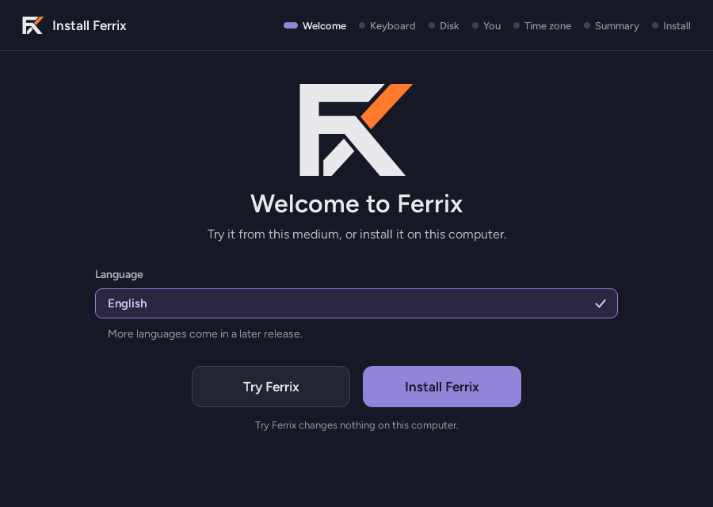 | 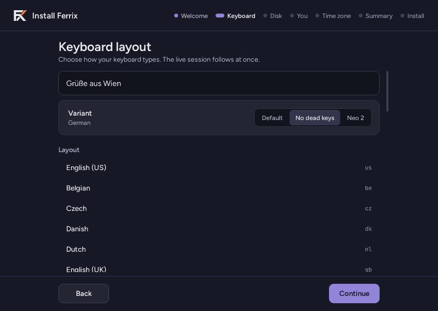 |
| 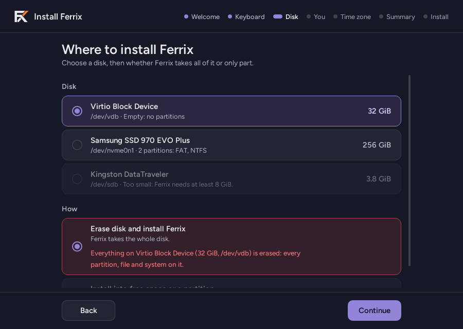 | 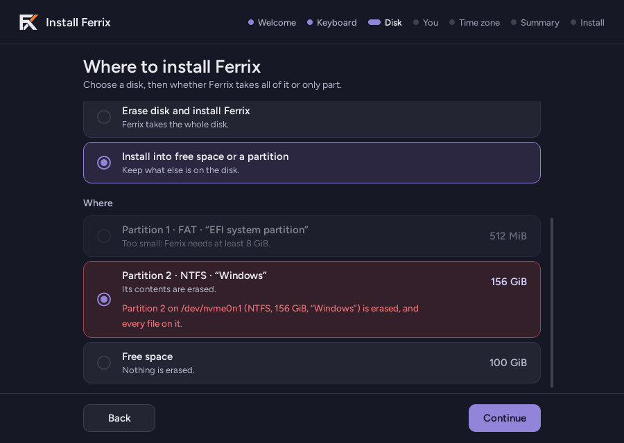 |
| 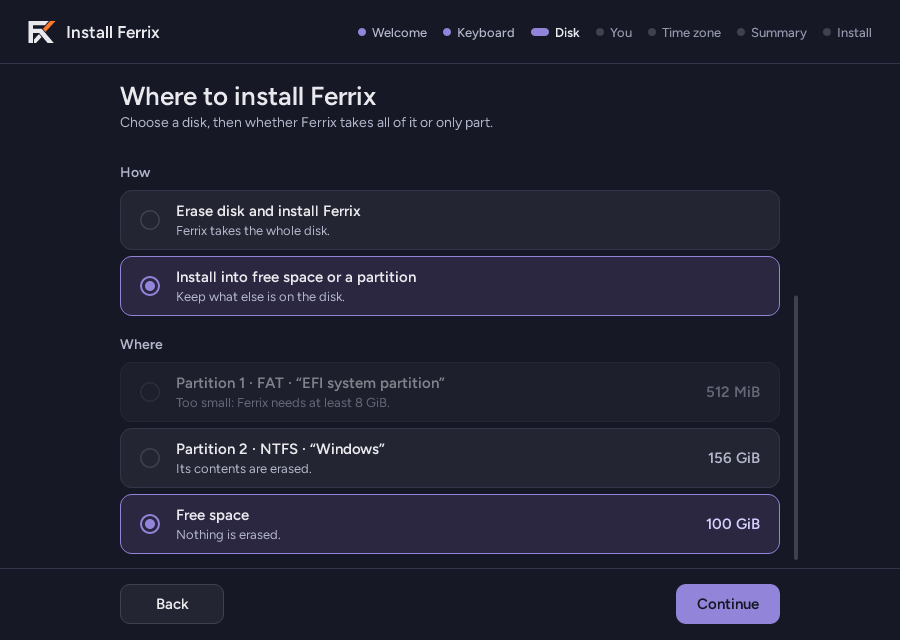 | 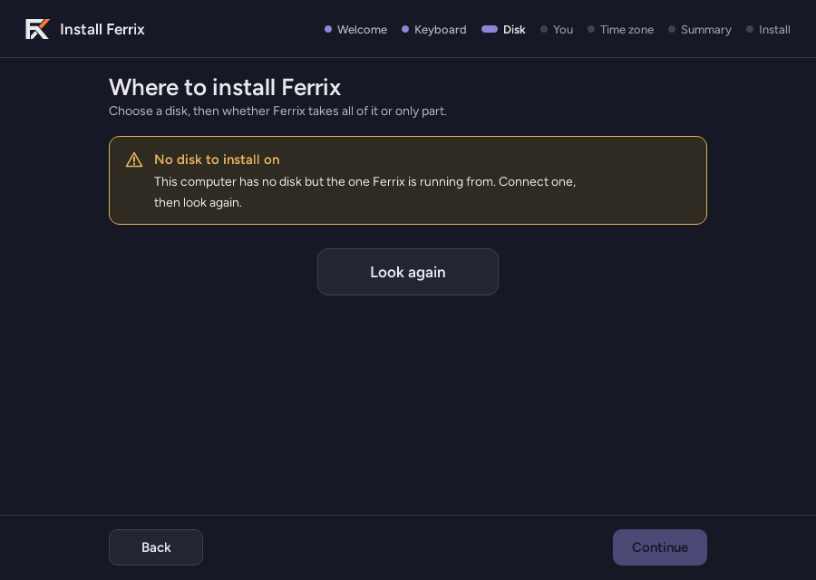 |
| 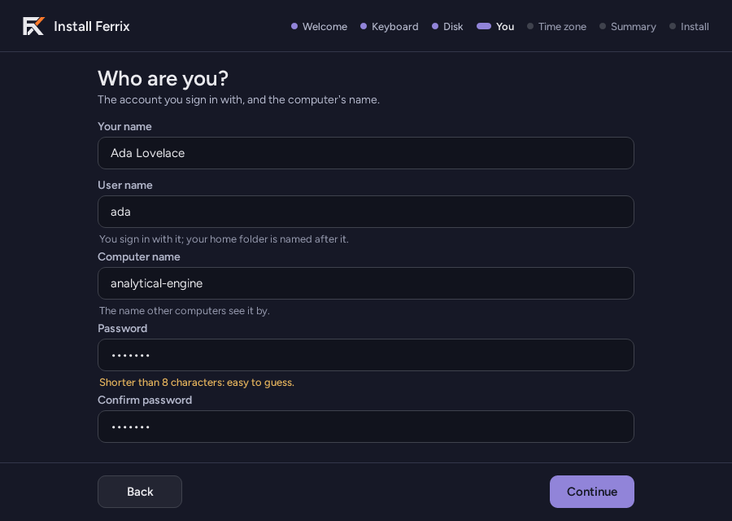 | 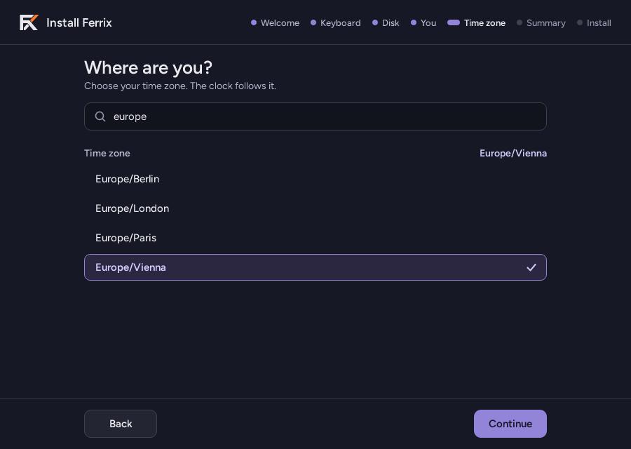 |
| 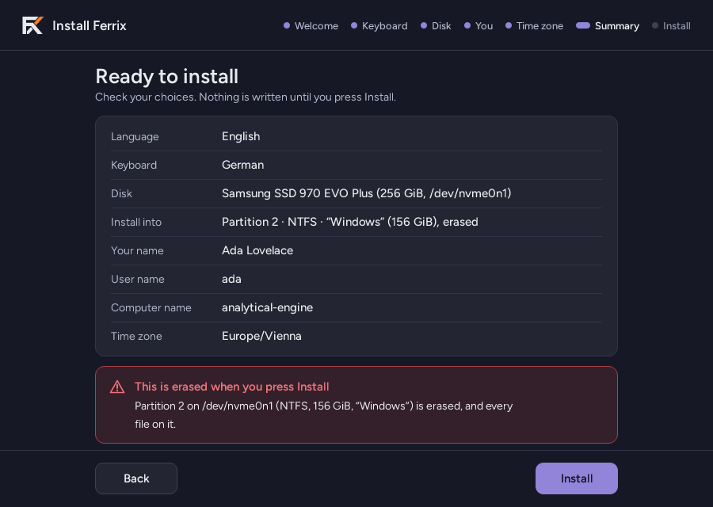 | 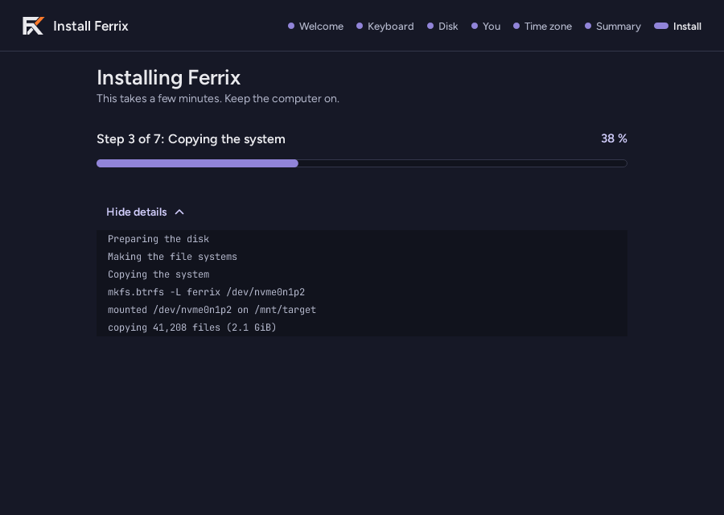 |
| 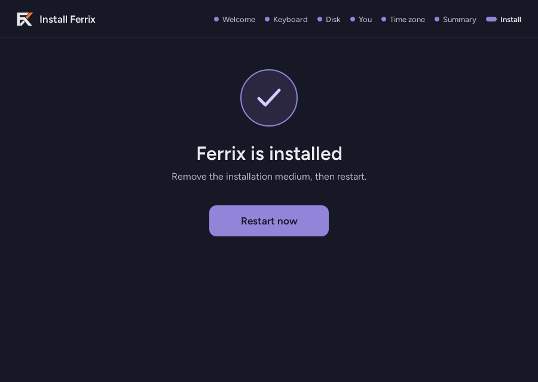 | 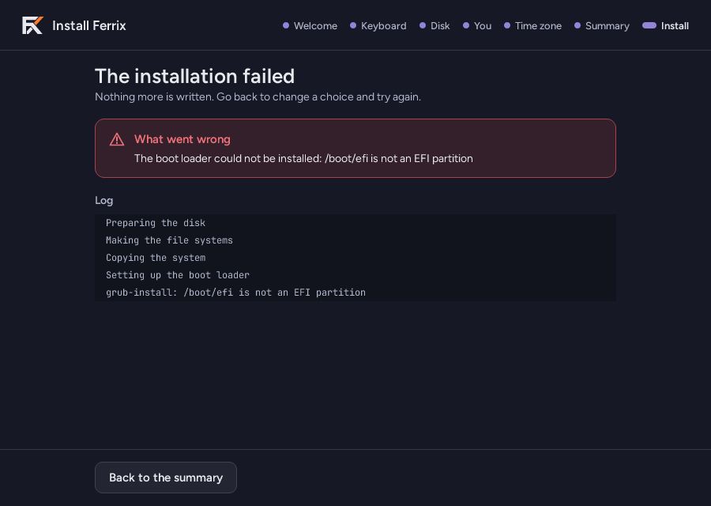 |

## Tests

`cargo test` here (and `cargo xtask check` with every app): the protocol's
reading and writing, the names checked, the zones read, the pages' order and
what each press does, and the window's tree driven headless against the
stand-in daemon -- the disks offered, a layout sent to the live session,
keys staying in the field they are typed into, an install streamed to Done
and one that fails, and every picture drawn on Nocturne's ground.
