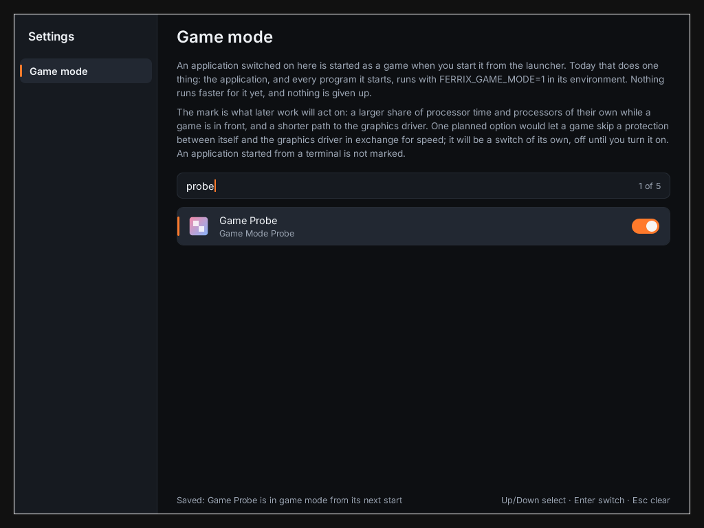

# settings

Settings: a window of pages, the first of them which applications are started in game mode. An app (Ferrix's [docs/APPS.md](https://github.com/ferrix-os/ferrix/blob/main/docs/APPS.md)): `app.toml` says what it installs and how it is built; its licence is `MIT`. Its design, the file it keeps and what game mode does and does not do are Ferrix's [docs/SETTINGS.md](https://github.com/ferrix-os/ferrix/blob/main/docs/SETTINGS.md).



*Settings' game-mode page after `probe` was typed and Enter pressed: the one application left has its switch on, and the foot says it was saved. On Ferrix (x86-64 under KVM), the screen `cargo xtask test-compositor --boot settings` keeps, on branch `settings-app`, 2026-10-11; nothing edited after capture.*

- **The page** lists every application a launcher lists, with its icon, and a switch each. Type to filter; Up and Down select; Enter turns the switch; Escape clears the filter; the pointer selects, switches and scrolls.
- **The switches** are the user's `~/.config/ferrix/game-mode.conf`, one desktop-file ID a line, replaced whole at each change. The launcher reads it when it starts an application and gives a switched-on one `FERRIX_GAME_MODE=1`. That is all game mode does today, and the page says so.
- **`settings --list`** prints the same list with no window: `on` or `off`, the ID, the name.

```
cargo xtask check                                          # its fmt, clippy and tests
cargo xtask test-apps --arch x86_64                        # a boot that runs its [[smoke]] lines
cargo xtask test-compositor --arch x86_64 --boot settings  # the desktop, a switch turned, the mark checked
cargo xtask run-compositor                                 # a desktop with it in the launcher
```

The list of applications, their icons and the file's format are Ferrix's `compositor-desktop`, which the launcher reads them with too; the window is `compositor-toolkit`, the text `compositor-text`, the icons `compositor-image`.
