# settings

Ferrix's Settings, after the customer's design: a sidebar of four groups --
Desktop, Session, System, Advanced -- and thirteen pages, a search over them,
and the page shown, drawn with tole (Ferrix's
[docs/UI-FRAMEWORK.md](https://github.com/ferrix-os/ferrix/blob/develop/docs/UI-FRAMEWORK.md))
in the design's Figtree and JetBrains Mono, dark first, light too, in one of
seven accents. An app (Ferrix's
[docs/APPS.md](https://github.com/ferrix-os/ferrix/blob/develop/docs/APPS.md)):
`app.toml` says what it installs and how it is built; its licence is `MIT`,
the fonts' the SIL Open Font License (`LICENSE-figtree`,
`LICENSE-jetbrains-mono`).

- **The window** (`ui/*.tole`, `src/ui.rs`): the header with the search and
  who is signed in where; the sidebar, the shown page's group open, a badge
  on a page with changes waiting; the page, its title, then its rows, each a
  kind the markup draws -- a heading with its note, a card with a segmented
  choice, a switch, a slider, a tick box, lines of label and value, a line to
  type in.
- **The search** narrows the sidebar to the pages whose name or words match
  (`blur` finds Appearance, `ssh` Remote login), and says "No setting
  matches" when none does.
- **A note** under a setting says when its change takes effect: "Takes effect
  after you sign in again", after a restart, or "Not kept yet".
- **The pages backed today** (Ferrix's
  [docs/RUNTIME-SETTINGS.md](https://github.com/ferrix-os/ferrix/blob/develop/docs/RUNTIME-SETTINGS.md)
  §3.3), every change made through hyprix, at once and kept:
  - *Appearance*: the desktop drawn small; the accent, which colours the
    window borders and the shadow too; spacing, corners, see-through windows,
    animations -- or, in Advanced, each gap, the border, the rounding, the
    others' opacity, blur and shadows. `hyprctl setting KEY VALUE`, kept in
    `~/.config/hypr/settings.conf`.
  - *Windows*: the layout (spiral, main and stack, one at a time, scrolling,
    floating), title bars, focus following the pointer.
  - *Displays*: the displays as they are placed, and the picked one's
    resolution, refresh rate, scale and rotation: `hyprctl keyword monitor`,
    kept by hyprix in `monitors.conf`.
  - *Keyboard*: a line to try, the layout typed in and the button that
    switches it (`hyprctl switchxkblayout`), the layouts Ferrix ships, the
    first ticked the default, and key repeat.
  - *Idle and lock*: when the screen locks and goes off, written into
    `~/.config/hypr/hypridle.conf` for the next sign-in (one written by hand
    is left alone and said so), and the unlock grace, live.
  - *Wallpaper*: the displays drawn with what each shows; the same on all,
    different on each or one picture spanning them; a picture -- the
    design's six, shipped in `share/wallpapers`, or one's own through tole's
    file chooser, which takes pictures -- with its fit, a plain colour, or a
    slideshow of a folder with its pace and shuffle; video is said, not
    chosen yet; the wallpaper under the lock screen. Each is one of hyprix's
    `wallpaper` lines through `hyprctl setting`, drawn at once.
  - *Name and time*: the computer's name, shown with "Not kept yet" until the
    settings writer can keep it, and About.
  - *Remote login* shown, not changed, until the settings writer turns sshd
    on and off; Power, Users, Logs and Boot options say they come with it.
- **Game mode** lists every application a launcher lists, each with a switch:
  the user's `~/.config/ferrix/game-mode.conf`, one desktop-file ID a line,
  which the launcher reads when it starts one (Ferrix's
  [docs/SETTINGS.md](https://github.com/ferrix-os/ferrix/blob/develop/docs/SETTINGS.md)).
  Its filter has the keys when the page opens; Return turns the first
  application it leaves.
- **`settings --render PAGE FILE`** draws a page headless, `--light` for the
  light palette; **`settings --list`** prints game mode's list with no window.

| | Dark | Light |
|---|---|---|
| Appearance | 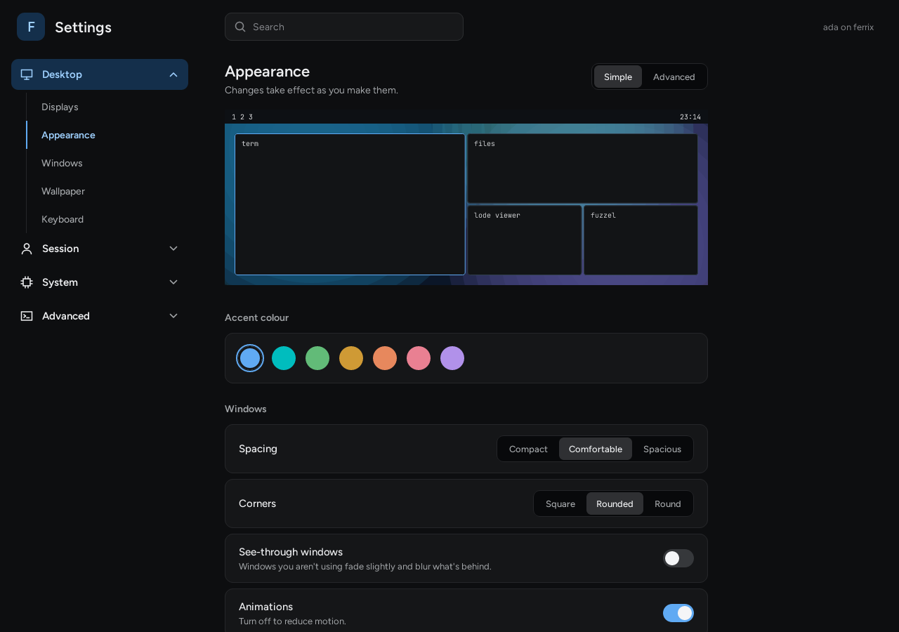 | 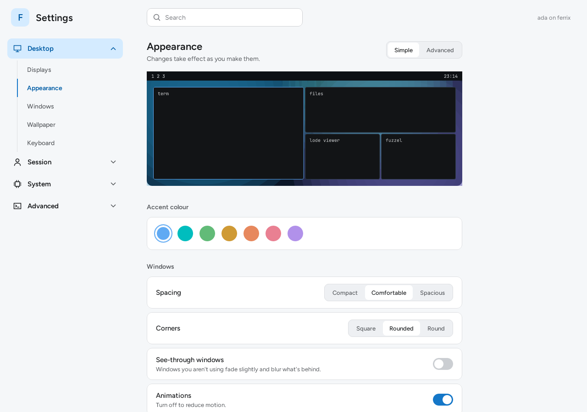 |
| Windows | 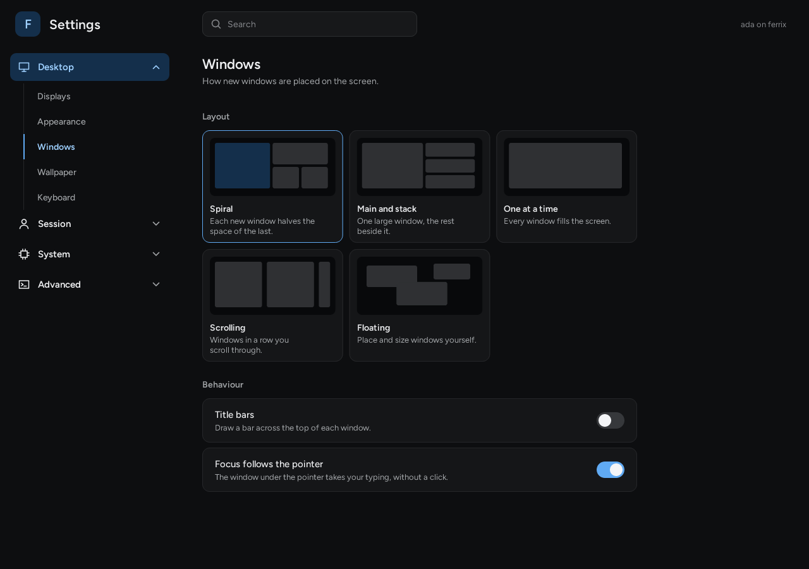 | 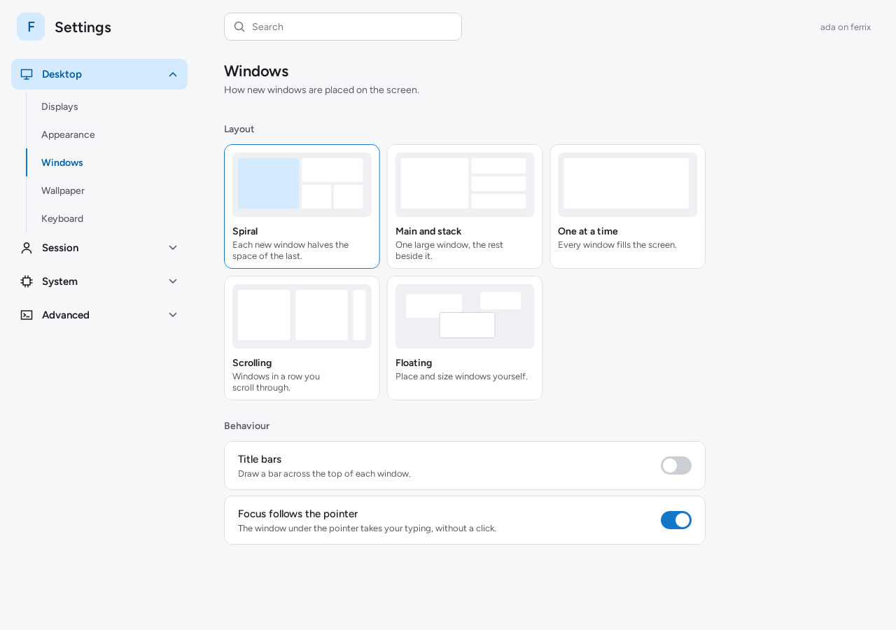 |
| Displays | 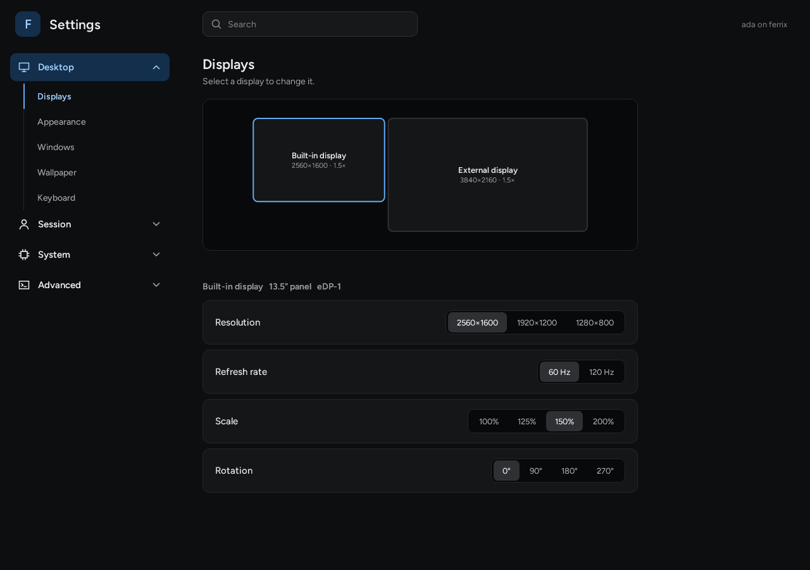 | 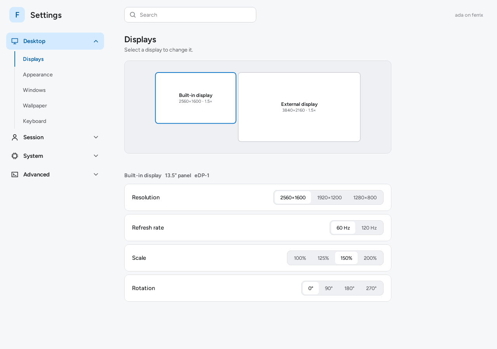 |
| Keyboard | 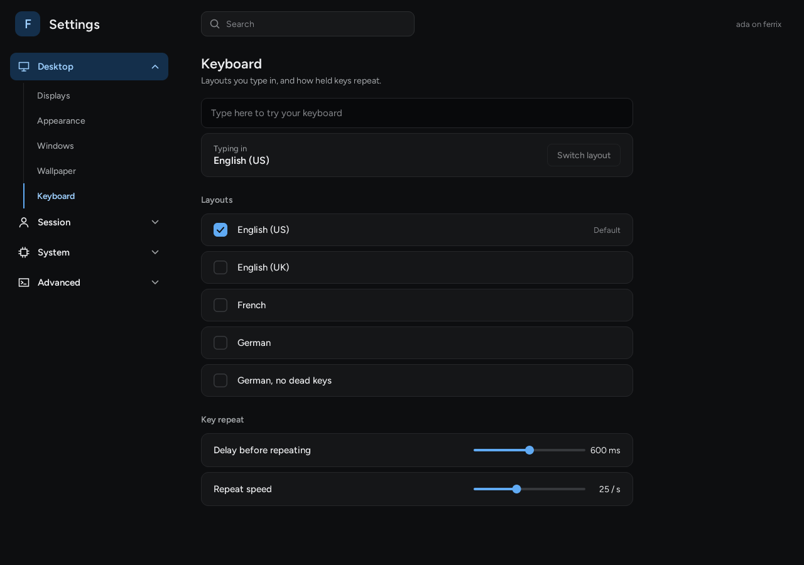 | 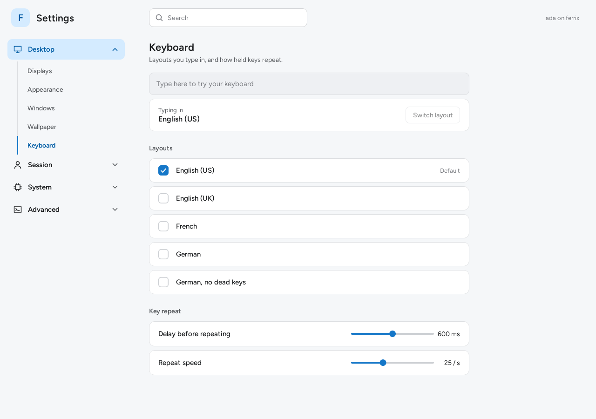 |
| Wallpaper | 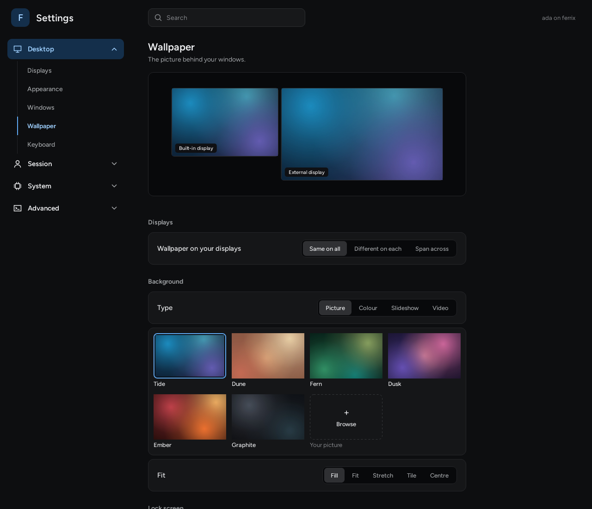 | 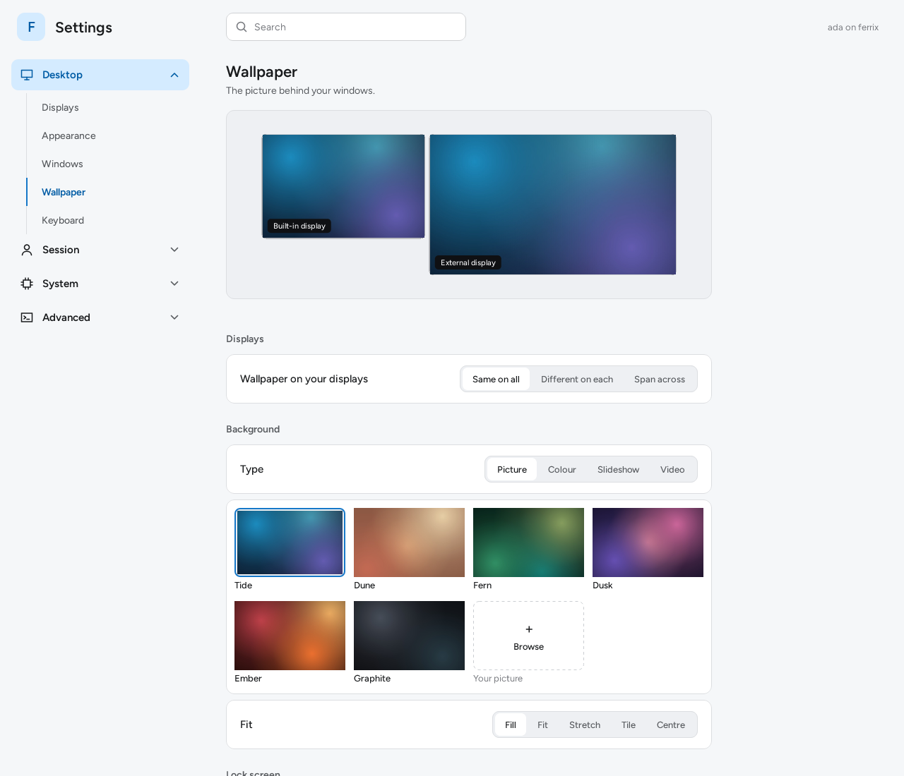 |
| Idle and lock | 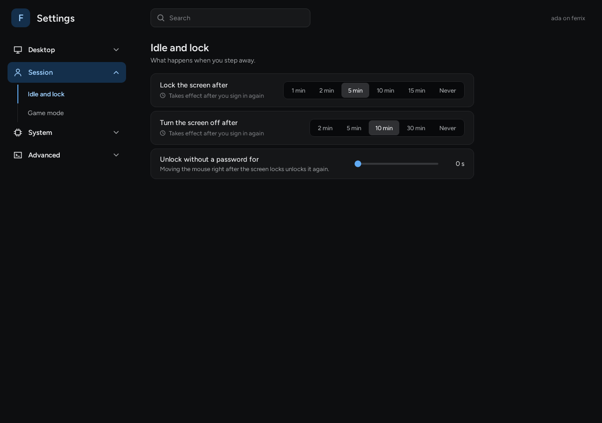 | 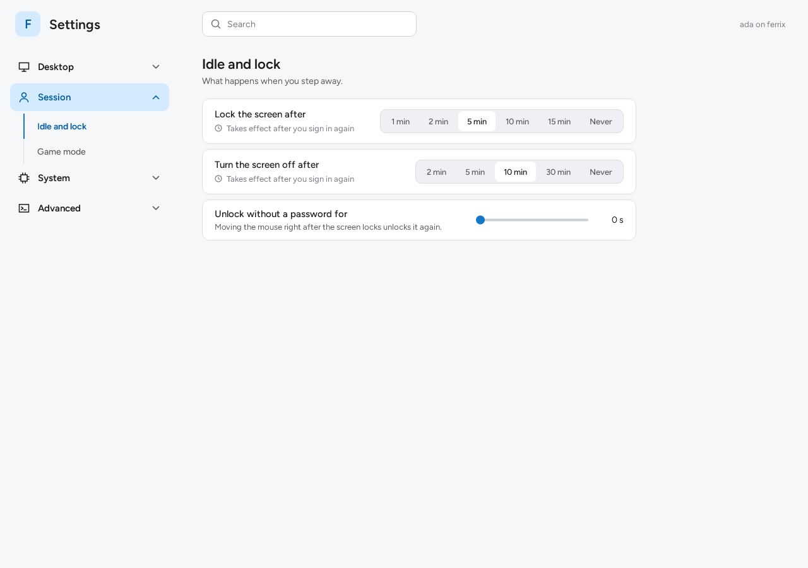 |
| Game mode | 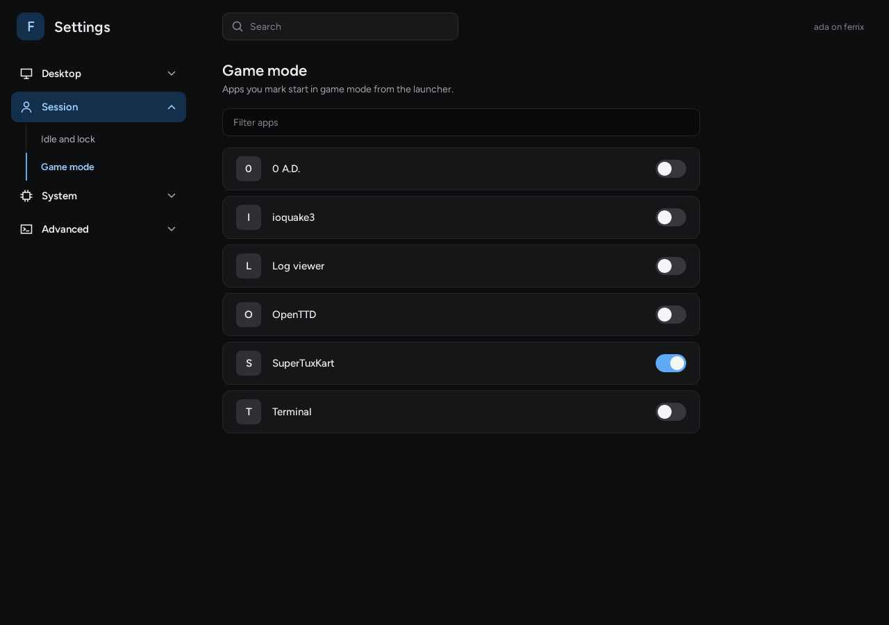 | 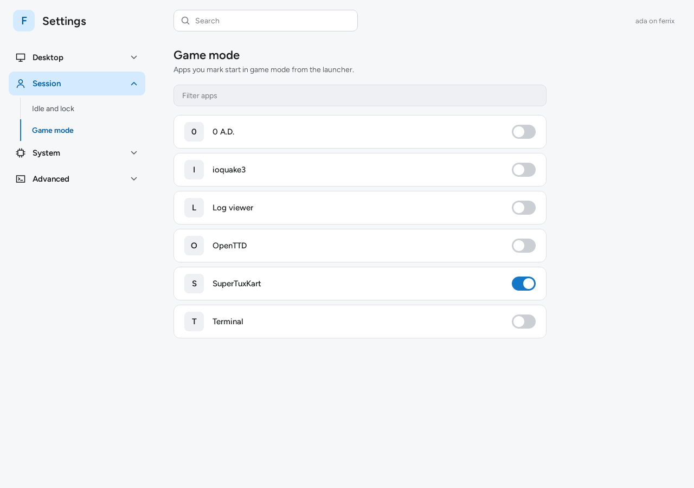 |

*Drawn headless by `settings --render PAGE FILE [--light] --size 1280x900`
with `SETTINGS_FAKE=1` (two displays and settings as the design shows them),
`USER=ada`, `SETTINGS_HOSTNAME=ferrix` and six applications; nothing edited.*

```
cargo xtask check                                          # its fmt, clippy and tests
cargo xtask test-apps --arch x86_64                        # a boot that runs its [[smoke]] lines
cargo xtask test-compositor --arch x86_64 --boot settings  # game mode on Ferrix: a switch turned, the mark checked
```
