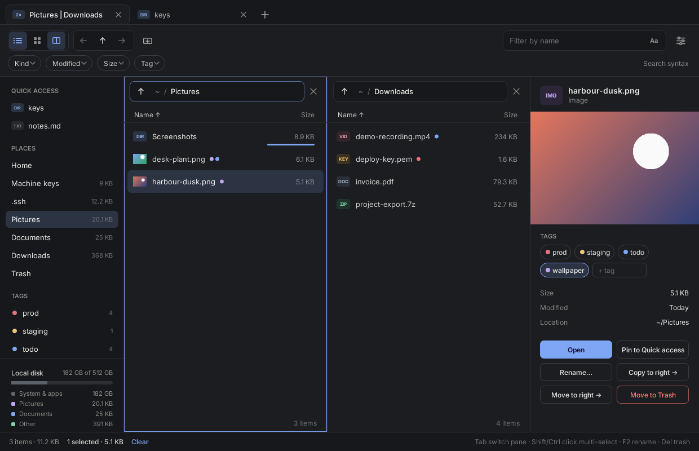
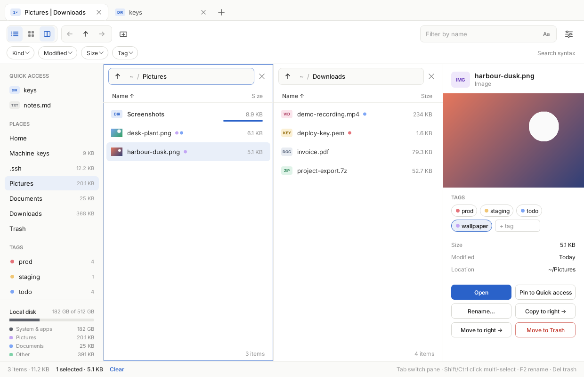
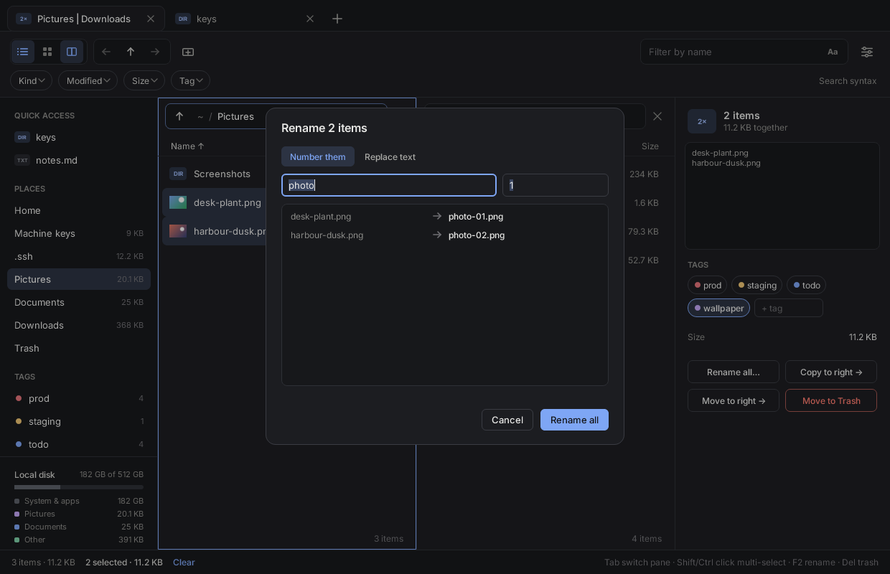
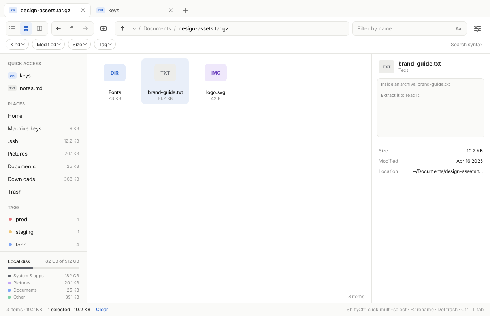
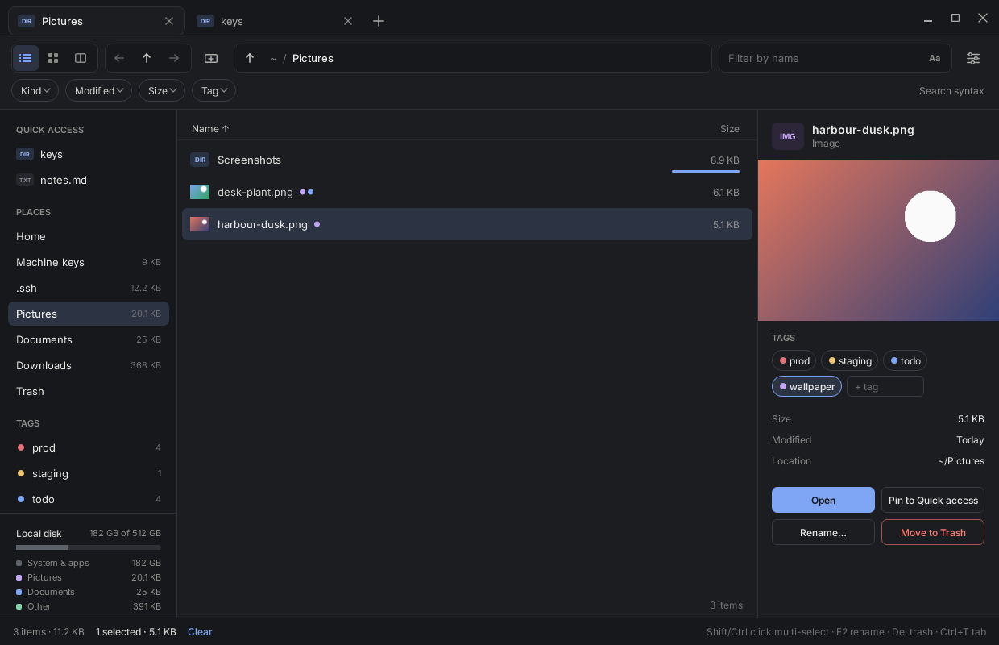

# shelf

Ferrix's file manager, after the customer's "File Explorer v2" design:
tabs, one pane or two side by side, a list or a grid with thumbnails,
folder sizes added up as you look, archives walked into in place, tags,
Quick access, filter chips, a search in three modes, bulk rename, and a
trash that GNOME's Files and KDE's Dolphin share. Its window is drawn by
[tole](https://github.com/ferrix-os/tole), Ferrix's UI framework, on the
CPU; it runs on Ferrix's desktop and on any Linux Wayland desktop.





## What it does

* **Tabs** (Ctrl+T, Ctrl+W), each with **one pane or two** (the third
  view button; Tab switches between them). Back and Forward keep each
  pane's history; Up and Backspace go to the folder above; the
  breadcrumbs go anywhere above. One pane shows them in the tool row,
  between the buttons and the search; two show them over each pane.
* **Its own title bar** where the compositor agrees (`xdg-decoration`'s
  `client_side`, which hyprix gives it under Yoru's title bars, or a
  compositor with no title bars at all): the tab row then has minimize,
  maximize and close at its end, moves the window when pressed between
  the tabs and maximizes it on a double click. Where the compositor draws
  its own title bar over the window, the row is only tabs.
* **List or grid.** The list sorts by name, kind, size or date (click a
  column; again to turn it round), folders first unless the settings say
  otherwise; the grid shows pictures' thumbnails. Compact rows, hidden
  files, extensions and the preview pane are in the settings menu.
* **Folder sizes**, added up on a thread of their own so a large folder
  never holds the window, without following links or leaving the file
  system; each folder's bar shows it against its largest neighbour, and
  the places down the side carry theirs. The disk at the foot of the
  sidebar is split into what is in Pictures, Documents, Videos, the rest
  of home, and the system.
* **Archives**: a `.zip`, `.tar`, `.tar.gz` or `.tgz` opens as a folder,
  read only; "Extract here" unpacks it into a new folder beside it,
  refusing any name that would climb out of it. Other kinds (`.7z`,
  `.rar`, `.xz`, `.zst`) are shown as archives, not read.
* **Tags**: given in the preview (click one to give or take it, type a
  new one), shown as dots on the rows, listed down the side where a click
  shows every file with that tag. They are kept in
  `$XDG_DATA_HOME/shelf/tags`, a line per file, and follow a file shelf
  moves or renames.
* **Quick access**: pin a folder or a file from the preview; kept in
  `$XDG_CONFIG_HOME/shelf/quick`.
* **Filter chips** for kind, date, size and tag, and the **search** in
  three modes, chosen from the menu in its field: the name contains the
  text; a pattern (`*.png | my?.txt | [image]`); a regular expression
  found in the name (`^id_.*$`). A pattern that cannot be read says why.
* **Changes ask first**: copy and move (to the other pane, F5 and F6),
  move to the trash (Delete), rename (F2; several files at once are
  numbered or have a text replaced, every new name shown and checked
  before anything happens), a new folder (Ctrl+Shift+N), extract. A name
  already taken never gets overwritten: the newcomer gets `name 2.ext`.
* **The trash** follows the freedesktop.org Trash specification:
  `~/.local/share/Trash/files` and `info/*.trashinfo`, so items put there
  by other programs show and can be restored, and vice versa. Restore puts
  an item back (under a new name if its old one is taken); "Delete for
  good" and "Empty trash" are the only deletions, and they ask.
* **The preview**: a picture, the start of a text file, a folder's or an
  archive's names, and a private key's first and last lines with its
  contents hidden; its size, date and place.







## Running it

On Ferrix it is in every image a person runs (`Files` in the launcher).
On a Linux desktop:

```
bash src/user/apps/shelf/install-linux.sh     # into ~/.local
shelf ~/Downloads
```

`shelf --version` says which it is; `shelf --demo` opens on a made-up
home folder; `shelf --render FILE [--light] [--scene main|rename|archive]`
draws that home without a desktop, which is how the pictures above are
made, and a test fails when one of them no longer matches what shelf
draws:

```
cargo run -- --render screenshots/dark.png
cargo run -- --render screenshots/light.png --light
cargo run -- --render screenshots/rename.png --scene rename
cargo run -- --render screenshots/archive.png --scene archive --light
cargo run -- --render screenshots/single.png --scene single --light
cargo run -- --render screenshots/own-frame.png --scene own-frame
```

## Licence

MIT, as the rest of Ferrix. It links tole (MIT), the compositor's
`compositor-image` decoders through tole, `libc` (MIT or Apache-2.0) for
the disk's size, and `miniz_oxide` (MIT, zlib or Apache-2.0) for zip's
and gzip's deflate.
