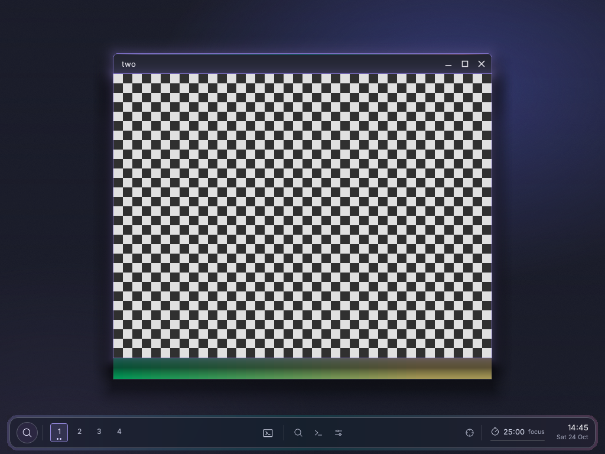

# yoru-shell

Yoru's shell: the dock of the customer's "Yoru WM" design (Ferrix's
[docs/DESKTOP.md](https://github.com/ferrix-os/ferrix/blob/develop/docs/DESKTOP.md)
§6), a layer-shell surface floating above the foot of the screen, drawn
with tole in the Nocturne design system's tokens, Inter for words and
Phosphor for icons. An app (Ferrix's
[docs/APPS.md](https://github.com/ferrix-os/ferrix/blob/develop/docs/APPS.md)):
`app.toml` says what it installs and how it is built; its licence is `MIT`, and the Phosphor icon font it carries
(`share/fonts/Phosphor.ttf`, Phosphor 2.1.1) is MIT too (`LICENSE-phosphor`).

- **The workspaces**, one to four always (code, docs, misc, free) and any
  other that exists, the one shown lit in the accent, a dot for each of
  its windows up to three. A press goes there.
- **The launchers**: the terminal, and the browser, Files (shelf) and
  Settings where the image has their desktop entries; nothing else is
  shown; a mark under one whose window is on the
  workspace shown. A press starts it through hyprix (`dispatch exec`).
- **The tools**: the search (fuzzel, until Yoru's own palette), the
  scratchpad terminal (`togglespecialworkspace scratch`), Settings.
- **Focus mode**: every window but the focused one dimmed
  (`decoration:dim_inactive`).
- **The pomodoro**: 25 minutes of focus, then 5 of break, its progress
  under it; a press starts or pauses it.
- **The clock** and the date, in UTC or `TZ=UTC±h` (Ferrix keeps no zone
  database).

It follows hyprix through Hyprland's IPC: `.socket2.sock`'s events, and
`j/workspaces`, `j/activeworkspace` and `j/clients` after each one that
moves something. Yoru's theme starts it (`exec-once`) and blurs what is
behind it (`layerrule = blur true, match:namespace ^(yoru-.*)$`).

`yoru-shell --render FILE` draws the dock of a sample desktop into a PNG,
as above; `cargo test` checks the model, the IPC's events and a drawn dock.
